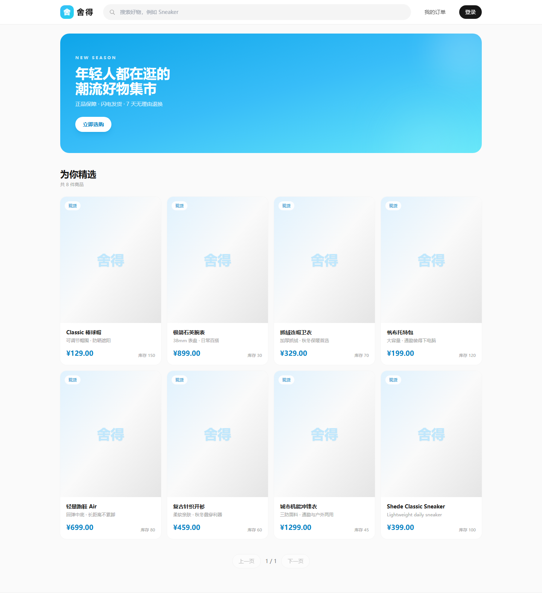
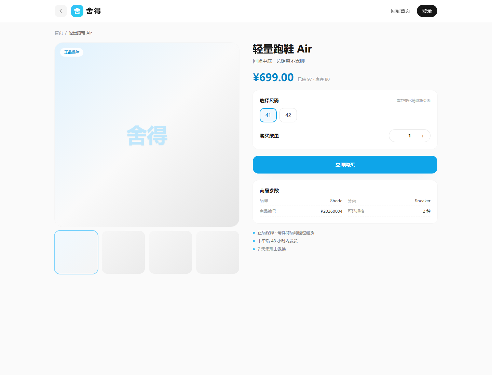
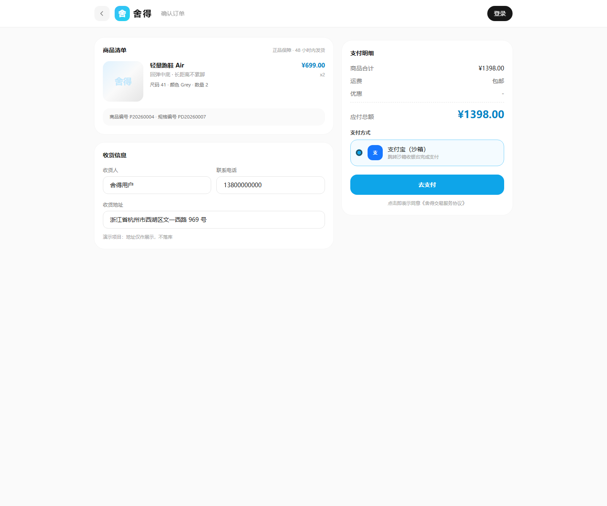
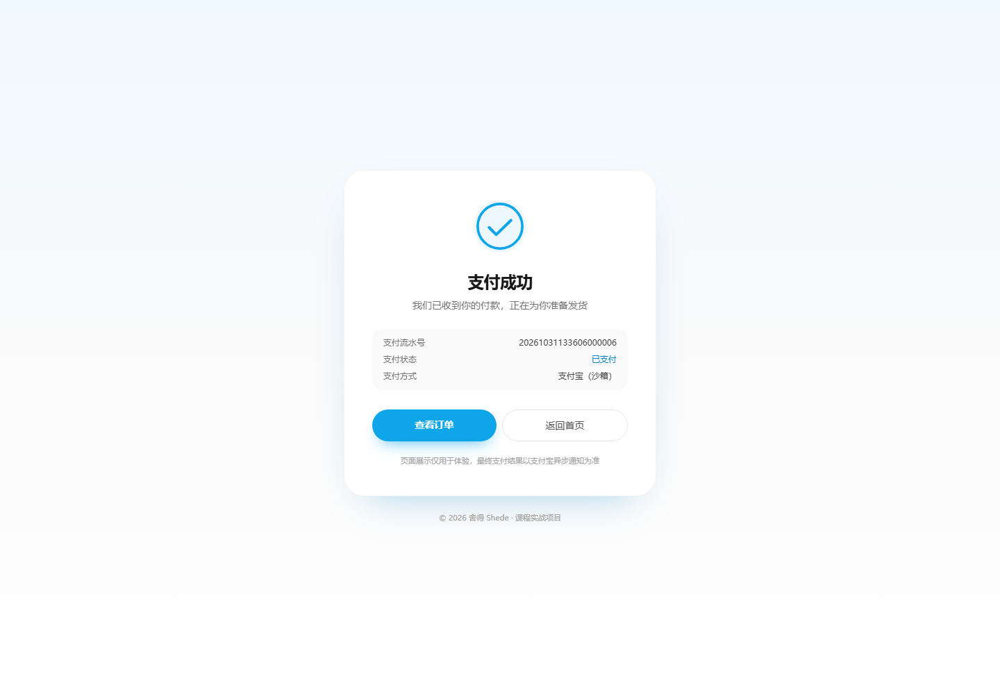
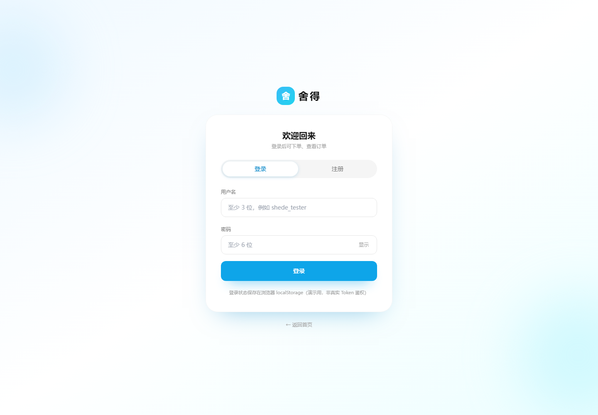
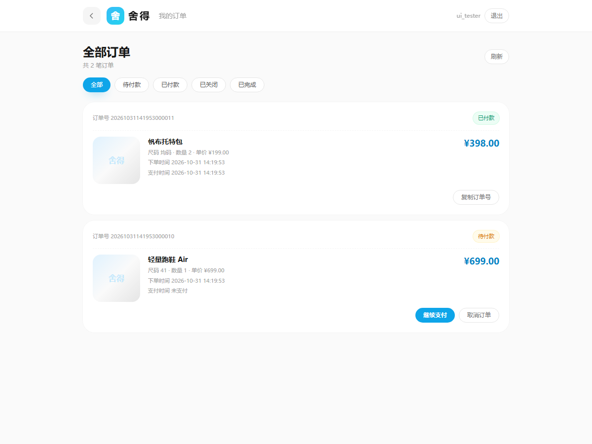

# 舍得 Shede · B2C 交易平台

> Spring Boot 2.7 + MyBatis + MySQL 8 + Redis + Redisson + 支付宝沙箱
> 从商品浏览到支付回调的完整交易闭环，含前端页面与并发防护。



---

## 1. 技术栈

| 层 | 选型 |
|---|---|
| 框架 | Spring Boot 2.7.18 / Spring 5.3 |
| 持久层 | MyBatis 2.3.1 + PageHelper 1.4.7 |
| 数据库 | MySQL 8.0（utf8mb4） |
| 缓存/分布式 | Redis 7 + Redisson 3.17.7（RAtomicLong 订单号） |
| 支付 | 支付宝开放平台 SDK 4.38（沙箱） |
| 前端 | 原生 HTML + Tailwind CDN + Fetch API（无框架、无构建） |
| 构建 | Maven，Java 8 字节码，Docker 多阶段构建 |

---

## 2. 业务流程

```
浏览商品列表 ──> 商品详情(选尺码) ──> 订单确认页
                                        │
                                        ▼
                             创建订单（条件 UPDATE 扣库存）
                                        │
                                        ▼
                          发起支付（生成 PENDING 流水 + 表单）
                                        │
                          ┌─────────────┴─────────────┐
                          ▼                           ▼
                 支付宝沙箱收银台              用户取消/超时
                          │                           │
                   异步通知(验签+幂等)          关单 + 恢复库存
                          ▼                           ▼
                 订单已付款 / 流水 SUCCESS      订单已关闭
```

---

## 3. 目录结构

```
shede/
├── pom.xml
├── Dockerfile                    多阶段构建（maven → jre）
├── docker-compose.yml            app + mysql + redis 一键启动
├── .env.example                  环境变量模板
├── sql/
│   ├── shede.sql                 建库建表（user/product/product_detail/order/payment_record）
│   └── seed-data.sql             8 个演示商品、13 个 SKU（幂等）
├── docs/
│   ├── api-test.md               Postman 全流程测试文档
│   └── shot-*.png                各页面效果截图
└── src/main/
    ├── java/com/youkeda/shede/
    │   ├── Application.java
    │   ├── AlipayConfig.java     支付宝客户端 Bean
    │   ├── api/                  5 个接口类：UserApi / ProductApi / ProductDetailApi / OrderApi / PaymentApi
    │   ├── control/              PaymentController（支付宝跳转+回调）、GlobalExceptionHandler、WebLogAspect
    │   ├── service/ + impl/      6 组服务：User / Product / ProductDetail / Order / PaymentRecord / Pay
    │   ├── dao/                  5 个 Mapper 接口
    │   ├── dataobject/           5 个 DO（严格对应表字段）
    │   ├── model/                业务模型 + 枚举 + Result/PageResult/Paging/PayResult/BizException
    │   ├── param/                7 个请求参数（BasePageParam 是分页基类）
    │   └── util/                 UUIDUtils / MD5Utils
    └── resources/
        ├── application.properties
        ├── com/youkeda/shede/dao/  5 个 Mapper XML（路径与包名一致）
        └── static/               6 个前端页面 + js/app.js
```

**分层职责**

| 包 | 干什么 | 一句话 |
|---|---|---|
| `api` | HTTP 入口，返回 JSON | 接参数、调 service、包 `Result` |
| `control` | 面向第三方/页面的入口 | 支付宝回调与跳转页（返回纯文本/HTML） |
| `service` + `impl` | 业务规则、事务、并发控制 | 扣库存、算金额、验签、幂等都在这里 |
| `dao` | 数据库访问接口 | 只有方法签名，SQL 在 XML |
| `dataobject` | 表结构映射（DO） | 有 id / 密码 / 时间字段 |
| `model` | 给前端的数据 + 公共件 | 无密码、状态带中文、统一 `Result` |
| `param` | 请求参数 | 收参白名单，防前端篡改价格/状态 |
| `util` | 工具类 | 业务号、密码哈希 |

---

## 4. 快速开始

### 方式 A：Docker（推荐，一条命令）

```bash
cp .env.example .env          # Windows: copy .env.example .env
docker compose up -d --build
docker compose logs -f app    # 看到 "Started Application in xxx seconds" 即可
```

打开 <http://localhost:8081>。

- 首次启动自动建库建表 + 导入演示商品（`sql/` 下的两个文件）。
- 想重新初始化数据：`docker compose down -v` 再 `up`。
- 只启动中间件、应用跑在 IDE：`docker compose up -d mysql redis`。

### 方式 B：本地运行

```bash
# 1. MySQL 建库建表
mysql -uroot -p < sql/shede.sql
mysql -uroot -p shede_db < sql/seed-data.sql     # 演示数据（可选）

# 2. 启动 Redis（默认 127.0.0.1:6379）
redis-server

# 3. 改 application.properties 里的数据库密码，然后
mvn spring-boot:run
# 或 IDEA 直接运行 Application
```

### 配置项

| 属性 | 说明 | 默认 |
|---|---|---|
| `server.port` | 服务端口 | `8081` |
| `spring.datasource.*` | MySQL 连接 | `localhost:3306/shede_db` |
| `spring.redis.*` | Redis 连接 | `localhost:6379` |
| `alipay.app-id` / `private-key` / `alipay-public-key` | 沙箱密钥 | 占位符，不填也能启动 |
| `alipay.notify-url` | 异步通知地址 | `http://localhost:8081/alipaycallback` |
| `alipay.return-url` | 同步跳转地址 | `http://localhost:8081/alipayurl.html` |

> 容器部署时用环境变量覆盖：`SPRING_DATASOURCE_URL`、`SPRING_REDIS_HOST`、`ALIPAY_APP_ID` 等。

---

## 5. 页面

| 页面 | 路径 | 说明 |
|---|---|---|
| 商品首页 | `/index.html` | 搜索、分页、卡片网格 |
| 商品详情 | `/product-detail.html?productId=` | 尺码选择、数量、立即购买 |
| 订单确认 | `/order-confirm.html` | 商品/尺码/总价、去支付（注入支付宝表单） |
| 登录注册 | `/login.html` | 登录态存 localStorage |
| 我的订单 | `/orders.html` | 状态筛选、继续支付、取消订单 |
| 支付结果 | `/alipayurl.html` | 对勾动画，支付宝 return_url |

---

## 6. 接口清单

| 方法 | 路径 | 说明 |
|---|---|---|
| POST | `/api/user/register` | 注册（密码 MD5 + 盐） |
| POST | `/api/user/login` | 登录校验 |
| GET | `/api/user/{userId}` | 查询用户 |
| GET | `/api/product/list` | 分页查询（PageHelper） |
| GET | `/api/product/detail?productId=` | 商品详情 + SKU 列表 |
| POST | `/api/order/create` | 下单（扣库存 + 生成订单号） |
| GET | `/api/order/{orderId}` | 订单详情 |
| GET | `/api/order/list?userId=&status=` | 我的订单 |
| POST | `/api/pay/alipay` | 发起支付，返回支付宝表单 |
| POST | `/api/pay/close?orderId=` | 取消订单并恢复库存 |
| POST | `/alipaycallback` | 支付宝异步通知（验签 + 幂等） |
| GET | `/alipayreturnurl` | 同步跳转（仅展示） |

统一响应：

```json
{ "success": true, "code": "200", "message": "success", "data": {}, "timestamp": 1793426000000 }
```
业务码：`4001` 参数/库存不足、`4010` 未登录、`4040` 不存在、`4090` 冲突、`500` 系统异常。

完整 Postman 流程见 [`docs/api-test.md`](docs/api-test.md)。

---

## 7. 核心设计

**① 防超卖（并发安全的关键）**
```xml
<update id="decreaseStockById">
    UPDATE product SET stock = stock - #{quantity}
    WHERE id = #{id} AND stock >= #{quantity}
</update>
```
条件更新 + `AND stock >= quantity`，影响 0 行即失败并回滚，不依赖先查后改。实测 50 线程抢 5 件库存：5 成功、45 失败、库存精确归零。

**② 订单号**
Redis `RAtomicLong` 全局自增 + 14 位时间戳，形如 `20261031133606000006`，跨实例唯一。

**③ 支付幂等**
先验签 → 查流水状态（已 SUCCESS 直接返回）→ 校验金额 → 先更新流水再更新订单，订单更新带 `WHERE status = 0`，重复通知不会二次执行。

**④ 事务边界**
`createOrder`（扣 SKU + 扣 SPU + 插订单）、`alipayCallBack`（流水 + 订单 + 库存）、`closeOrder`（恢复库存 + 关单 + 流水置失败）均为 `@Transactional(rollbackFor = Exception.class)`。

**⑤ 全局能力**
`GlobalExceptionHandler` 统一异常 → `Result`；`WebLogAspect` 记录 URI/参数（密码脱敏）/耗时。

---

## 8. 常见问题

| 现象 | 原因 | 处理 |
|---|---|---|
| 启动报 `Port 8081 was already in use` | 端口占用 | 改 `server.port` 或结束旧进程 |
| `Unable to connect to Redis` | Redis 未启动 / 配了密码 | 启动 Redis，或把 `spring.redis.password` 注释掉 |
| 页面 404 | 应用跑的是旧编译产物 | `mvn clean package` 后重启 |
| 支付报「发起支付失败」 | 未填沙箱密钥 | 填 `alipay.app-id` / `private-key` / `alipay-public-key` |
| 回调一直 `failure` | 公钥不匹配 | 确认用的是**支付宝公钥**而非应用公钥 |
| 数据要重置 | 初始化脚本只跑一次 | `docker compose down -v && docker compose up -d` |

---

## 9. 截图

| 首页 | 详情 |
|---|---|
|  |  |

| 订单确认 | 支付成功 |
|---|---|
|  |  |

| 登录 | 我的订单 |
|---|---|
|  |  |
